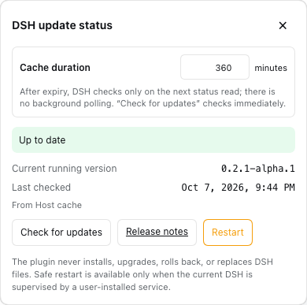

<h1 align="center">DSH Update Status</h1>

<p align="center">A DSH Web version-status panel with copy-only upgrade guidance and opt-in, supervised safe restart.</p>

<p align="center">
  <a href="https://www.npmjs.com/package/dsh-update-status"></a>
  <a href="https://github.com/idoall/dsh-update-status/actions/workflows/ci.yml"></a>
  <a href="LICENSE"></a>
</p>

<p align="center">English | <a href="README.zh.md">中文</a></p>

<p align="center">
  <a href="#features">Features</a> ·
  <a href="#install">Install</a> ·
  <a href="#usage">Usage</a> ·
  <a href="#update-check">Update check</a> ·
  <a href="#supervised-restart">Supervised restart</a> ·
  <a href="#lan--non-loopback-pages">LAN pages</a> ·
  <a href="#loadability-and-update-notices">Loadability</a> ·
  <a href="#configuration">Configuration</a> ·
  <a href="#troubleshooting">Troubleshooting</a> ·
  <a href="#security-boundary">Security</a> ·
  <a href="#uninstall">Uninstall</a> ·
  <a href="docs/RELEASING.md">Release guide</a>
</p>

> DSH Update Status is a community plugin for DeepSeek Harness. It does not modify DSH core, install or upgrade DSH, roll back DSH packages, download releases, or replace DSH files. It never installs an update and never restarts DSH on its own. It can request a **safe restart only after you explicitly install a user-level service** to supervise the current DSH Web process.

It shadows only the expanded sidebar brand name with `DeepSeek` plus a compact version chip that fits the 24px brand row, leaving the official fish mark untouched. A green dot next to the version means nothing newer is published; a breathing amber dot means at least one newer release exists — stable, release candidate or alpha. Tap the chip for the running version, one card per newer version, each with its own copy-only upgrade command, and the guarded **Restart** control that appears once you have installed user-level supervision.

<p align="center">
  
</p>

## Features

- **Visible version status** — shows the running DSH version in the expanded sidebar. Nothing is rendered while the sidebar is collapsed: DSH's `sidebar.footer.action` row is a single 36px cell above Settings, and a second registrant overflows it (it pushed a neighbouring plugin's entry off the screen edge), so the brand-row chip is the only entry.
- **Quiet update signal** — a pending update never repaints the version chip. Only an amber dot with a soft halo next to the version breathes (scale + glow; the animation is disabled under `prefers-reduced-motion`), so a new release reads as one small light instead of a recoloured brand row.
- **Three dot states, one glance** — with nothing to do the dot beside the version is a plain **green circle** (the theme's success colour, not the text colour, so a dark shell no longer paints a dot that reads as "off"). While a check is running it is the neutral grey pulse; a pending update is the amber halo. Only the update state animates or glows, and only a failed status read repaints the chip, in red.
- **Neutral chip surface** — the chip is a grey second-level surface in both themes (`#f1f3f5` light / `#353638` dark) with the theme's normal label colour, so the dark shell gets a dark grey chip with white text rather than a white pill that hides the amber halo.
- **Light, dark, or system — followed automatically** — every colour the plugin renders is a DSH semantic token, so the chip, the dot, its halo and the panel all resolve through whatever appearance DSH is using. Set DSH to light, to dark, or to system and the plugin switches with the shell: no plugin-side theme setting, no media query to keep in sync. Hover lifts the chip in both directions (darkened in light mode, lightened in dark mode) by mixing the theme's label colour into the surface.
- **One card per upgradable version** — every published version strictly newer than the running one gets its own card, newest first, and each card carries that version's own copy-only command. When nothing is newer there are no cards at all and the panel says the running release is the newest.
- **The newest card is the one that stands out** — the highest version gets an amber border and a **Newest** pill; every other card stays neutral. There is no sort control: the order is the version order, and only the top card is emphasized.
- **One release line, zero configuration** — reads npm's dist-tags in one registry request and keeps every version that is newer than the running one, stable, release candidate or alpha alike. There is no channel to follow and no choice to make.
- **An honest prerelease comparison** — the running version and each candidate are ordered with SemVer, so `0.2.1-rc.4` outranks `0.2.0-rc.2` and a release candidate still sorts below its own stable release.
- **Copy-only guidance, per version** — each card's command names that card's exact version, never a dist-tag that can move, and is never executed by the plugin.
- **No compatibility bookkeeping** — the panel no longer claims that a DeepSeek Harness release was tested with this build. What decides whether the plugin loads is DSH's own gate: the declared engine range and the `@deepseek-ai/dsh-settings` peer range.
- **Cache without polling** — one Host check on mount, a configurable 30–1,440 minute cache, single-flight registry access, and no frontend polling. Only the Check for updates button bypasses the cache.
- **Mobile-safe panel** — uses a modal browser top layer so the scrollable, safe-area-aware bottom sheet stays above the DSH drawer.
- **Supervised safe restart** — after a one-time service setup, the panel can restart DSH for you: it warns about the work it would interrupt, and refuses outright when DSH was started by hand or by the desktop app.

## Install

Requirements:

- DeepSeek Harness with the Web profile
- DeepSeek Harness `>=0.1.7-alpha.2 <0.3.0` — the range this plugin declares in `dsh.engines.dsh`, with the same bounds on the `@deepseek-ai/dsh-settings` peer. DSH refuses a bundle outside that range at profile load. There is no per-release tested list to consult: inside the range, the plugin is not waiting for a release to be "approved".
- Node.js 20 or newer

With an installed `dsh` command:

```sh
dsh plugin --profile web add dsh-update-status@latest
```

From a DeepSeek Harness source checkout:

```sh
corepack enable
pnpm install
pnpm dsh plugin --profile web add dsh-update-status@latest
```

Restart the existing DSH process after installation, then refresh its Web GUI. Do not start a second Web server for this plugin.

Local development link:

```sh
pnpm install --frozen-lockfile
pnpm run build
dsh plugin --profile web add "link:$(pwd)"
```

## Usage

1. Open the DSH sidebar drawer. The official fish remains in place; the name row shows `DeepSeek` plus the current version badge.
2. Tap the badge. The update panel opens without triggering the parent New Session action.
3. Read the running version. When nothing newer is published, the panel says the running release is the newest and there is no card to act on.
4. Otherwise every newer published version has its own card, newest first. A card shows the version, the dist-tag that carries it when npm reports one, its release line and publish date.
5. Copy the command from the card you want — each one is pinned to that card's exact version — and run it yourself in a terminal on the computer hosting DSH.
6. After the package-manager command completes, use the panel's **Restart** control only if you have completed [supervised restart](#supervised-restart); otherwise restart DSH yourself.

Example command on a card for a global install:

```sh
npm install -g @deepseek-ai/dsh@0.2.1-rc.4
```

Each card shows one command that matches the detected installation kind and names that card's exact release. The plugin does not run it. When the installation kind cannot take a package-manager command — a source checkout, for example — the panel shows that guidance once instead of a copy button on every card, rather than inventing a command.

### What the dot means

The dot beside the version carries the whole status, and only the update state animates:

| Dot | State | Meaning |
| --- | --- | --- |
| green circle | up to date | Nothing newer is published. The chip keeps its normal fill. |
| grey pulse | checking | A status read is in flight (first mount or **Check for updates**). |
| amber dot with a halo | update | At least one newer release exists. Copy a card's command, run it yourself, restart DSH. |
| chip turns red | failed read | The plugin could not determine the state: the registry read failed or two versions are not SemVer-comparable. |

<p align="center">
  
</p>

The chip itself is a neutral second-level surface — grey in both themes, with the theme's own label colour — so the amber halo always reads against it, and it never changes colour to announce an update.

## Update check

The plugin asks the npm registry for `@deepseek-ai/dsh` once per cache window, collects every published version a dist-tag points at, keeps the ones strictly newer than the running release, and lists them newest first. `latest`, `next` and `alpha` are npm bookkeeping, not a user choice: a newer release counts whichever tag carries it.

- Every tag npm returns counts, including one this plugin has never seen. A version can carry several tags; its card shows one, picked in the order `latest`, `next`, `alpha`, `beta`, `rc`, then others.
- SemVer decides the order, prereleases included, so an `alpha` ahead of the stable line is offered rather than hidden.
- The comparison is exact: `0.2.1-rc.4` is newer than `0.2.0-rc.2`, and both sort below `0.2.1`.
- The running version decides the list. Upgrading DSH and re-checking the panel shrinks it; installing an older one grows it.
- npm's web page shows only the `latest` tag on the package page; versions carried by other tags live on the Versions page. The panel does not copy that shortcut — it lists them.
- Nothing here installs anything, and nothing is applied on its own. Choosing to follow a channel — and the `channel` preference that stored it — was removed in `0.2.0`.

## Supervised restart

A plugin cannot restart DSH on its own: it lives inside the very process it would have to replace. So the button only works once your operating system owns that process — and every OS already ships a way to do that.

The shortest safe setup is explicit and terminal-driven:

```sh
# 1. Inspect the complete native-service plan. This writes and starts nothing.
dsh plugin --profile web exec dsh-update-status-service plan \
  --workspace "$PWD" --dry-run

# 2. Stage the user-service definition. This still does not start it.
dsh plugin --profile web exec dsh-update-status-service install \
  --workspace "$PWD"

# 3. Stop the terminal-started dsh web yourself, then activate the service.
dsh plugin --profile web exec dsh-update-status-service activate
```

`activate` stops if the port is still busy instead of killing anything, so the DSH you are already using is never taken down by surprise. It also checks afterwards that the service it just started really took over; a service that begins failing immediately is reported as a failure, not as a success. From then on, **Restart** lists what is running, asks for a second confirmation when something is, and lets DSH exit; the service starts it again and the page comes back on its own.

Only one thing may start DSH Web on that port. If another tool starts its own `dsh web` — a second plugin's restart helper, a `nohup` script — that process holds the port while your service keeps failing to start. The plugin asks your operating system which process the service really owns, so **Restart** stays disabled in that state instead of promising a recovery that cannot happen, and it shows the two copy-only commands that fix it: one to find whoever holds the port, one to give the service back. The generated service also stops after a few failed starts in a row rather than respawning forever, and writes the reason to its log. More detail: [user-service supervision](docs/service-supervision.md).

| Platform | User-level owner | Starts | Restart works after setup | Notes |
| --- | --- | --- | --- | --- |
| macOS | `launchd` LaunchAgent | at user login | Yes | First verified target; no administrator account required. |
| Linux | `systemd --user` | at user login | Implemented; verify on your host | `loginctl enable-linger` is optional for running after logout and is never enabled automatically. The unit template is render-tested but has not been run on a real Linux host yet. |
| Windows | Task Scheduler + current-user wrapper | at user logon | Template supplied; verify on Windows before production use | No administrator account required. |

The generated service files contain absolute paths, one audited `PATH`, and **no secrets** — never your API keys, npm tokens, cookies or proxy credentials. By default `install` saves the PATH of the terminal that ran it, so Homebrew, MacPorts, Nix, asdf, Conda, Cargo and hand-installed tools all follow the same rule; `--path-source minimal` keeps a fixed environment and `--service-path` supplies an explicit one. `plan --dry-run` shows the final value and every warning before anything is written. Native files, logs, status and removal: [user-service supervision](docs/service-supervision.md). To check Linux or Windows on your own machine: [platform acceptance](docs/platform-acceptance.md).

A restart interrupts running work and does not save it. If DSH cannot list what is running, cannot verify that your service owns the current process, or was started by hand or by the desktop app, it refuses to restart at all — a web page cannot talk it into it.

## LAN / non-loopback pages

Earlier DSH releases restricted non-loopback settings forms to memory-only state. DSH `0.2.1-rc.3` and later no longer expose that `mode` field in form snapshots: the official entry-addressed form calls the settings Remote directly. Do not infer current persistence or authorization from an origin check alone; the running Host's settings policy decides whether a write is accepted.

From `0.1.2` this plugin is fully usable there anyway:

- The version/update **status** is fetched normally. Earlier releases gated the whole feature on `connection.isLoopback === true`, so a page reached through a LAN bridge (`dsh-bridge`, `dsh-lan-proxy`, …) never sent `POST /api/dsh-update-status.get-status`, could not open the detail panel, and showed the release this bundle was built against as if it were the running version. That gate is gone — the Connection RPC is authenticated and the Host route is the plugin's own.
- **Preferences** (`sidebarEnabled`, `cacheTtlMinutes`) keep reading and writing the ONE shared Host settings entry `dsh-update-status`, through the same public Remote the official settings form speaks (`settings.describe` / `settings.mutate`). Writes stay revision-fenced, and a refused write surfaces as a conflict instead of a silent overwrite. The direct channel opens only when the official form reports `unavailable`, so a loopback page keeps the official path and pays no extra wire read.

A LAN bridge must preserve DSH's authenticated transport and Host authorization policy. This plugin does not change bridge configuration or grant settings access; a Host refusal must be resolved by the deployment operator.

## Loadability and update notices

This plugin does not vouch for any DeepSeek Harness release. Loading is DSH's decision, and DSH makes it from two declarations only: `dsh.engines.dsh` says `>=0.1.7-alpha.2 <0.3.0`, and the `@deepseek-ai/dsh-settings` peer range says the same. Inside those bounds you can run any DSH release you like; no plugin update is needed to "allow" a newer one.

`0.5.0` removed the earlier mechanism completely. There is no verified-release list, no `dsh.compatibility` metadata, no verified or unverified label in the panel, and no warning because a newer DSH release was untested. The plugin's job is only to say that a newer release exists and how to upgrade; keeping a compatibility ledger was out of scope, and it had produced six releases in 13 days whose headline was a declaration.

What remains is the update notice: one card per version newer than the running one, each with its own command. What the plugin knows about a release is what npm publishes — version, tag and publish date — and it says nothing about whether the release is good for you.

The rows below `0.5.0` in the table still mention that removed list; that is history, and no release now waits for a list entry.

### Plugin versions on npm

| Plugin | On npm | What that version is |
| --- | --- | --- |
| **`0.5.0`** | `latest` | One card per upgradable version, each with its own copy-only command; the verified-release mechanism is removed and DSH's engine and peer ranges alone decide loading |
| **`0.4.8`** | published | Added DSH `0.2.1-rc.4` to the then-current verified list, under the mechanism `0.5.0` removed; no functional code changed |
| **`0.4.7`** | published | Removes the redundant settings menu; version status and update notices remain on by default, with details in the sidebar chip panel |
| **`0.4.6`** | published | Added DSH `0.2.1-rc.3` to the then-current verified list; includes maintenance and starting terminals in restart confirmation, and restores restart-storm recovery guidance |
| **`0.4.5`** | published | Added DSH `0.2.1-rc.2` to the then-current verified list; no functional code changed |
| **`0.4.4`** | published | Added DSH `0.2.1-alpha.5` to the then-current verified list; no functional code changed |
| **`0.4.3`** | published | Added DSH `0.2.1-alpha.4` to the then-current verified list; no functional code changed |
| **`0.4.2`** | published | Added DSH `0.2.1-alpha.3` to the then-current verified list; no functional code changed |
| **`0.4.1`** | published | The service saves the PATH used during installation, so tools installed by any package manager stay available after DSH is supervised |
| **`0.4.0`** | published | Restart you can trust: the service stops instead of restarting forever, the button needs the service to really own the process, and a disabled button shows the two commands that recover it |
| **`0.3.2`** | published | Documentation only: the version table and every past release note are now plain language. Behaves exactly like `0.3.1` |
| **`0.3.1`** | published | Small polish: the panel explains Restart, and a long job name can no longer push the buttons away. |
| **`0.3.0`** | published | Adds **Restart** to the panel, plus the one-command service setup it needs. Without that service the button stays disabled and says why. |
| **`0.2.1`** | published | Hiding the version chip brings DSH’s own name and fish mark back, instead of leaving the brand row blank. |
| **`0.2.0`** | published | One update line instead of a channel picker: the panel reports the newest published version, and there is nothing to configure. |
| **`0.1.12`** | published | Added DSH `0.2.0-rc.2` to the then-current verified list; no code change. |
| **`0.1.11`** | published | Declared the DSH `0.2.0` line and widened the supported range, so a newer DSH could no longer drop the plugin without a word. |
| **`0.1.10`** | published | No more button in the collapsed sidebar rail — it did not fit there and pushed a neighbouring plugin’s icon aside. |
| `0.1.9` | published | Fixes the plugin disappearing after a DSH upgrade (a leftover copy of a shared library could take it down), and the panel says which folder to delete. |
| `0.1.8` | published | Added DSH `0.1.7-rc.2` to the then-current verified list; no code change. |
| `0.1.7` | published | The English UI is fully English now: status messages are rendered by the browser in its own language. |
| `0.1.6` | published | Adapts to DSH 0.1.7, where the plugin’s two preferences are stored as its own settings entry. |
| `0.1.5` | published | One dot carries every state (green up to date, grey checking, amber for an update), and advisory notices stop recolouring the chip. |
| `0.1.4` | published | Fixes the entry for the version you are running showing as unselectable. |
| `0.1.3` | published | Carries the LAN-page fix and was checked on the then-current DSH 0.1.6. |
| `0.1.2` | **never published** | Removes the loopback-only restriction, so a LAN page works too. |
| `0.1.1` | published | The previous npm `latest`; on a LAN page the plugin does nothing. |
| `0.1.0` | published | First release. |

- **Which version for which DSH?** `0.1.6`–`0.1.10` were built for the DSH `0.1.7` line; `0.1.11` and later also accept the `0.2.0` line. DSH 0.1.7 changed how a plugin stores its settings, so on an older DSH — including `0.1.6-alpha.2` — stay on plugin **`0.1.5`**.
- **Loadability is decided by DSH, not by a label.** If a DSH release refuses to load this plugin, disable or uninstall the plugin rather than editing DSH — and please report it. There is no tested-release list any more, and no list entry to wait for.
- **On npm** means what `dsh plugin --profile web add dsh-update-status@latest` actually installs. A version that exists in this repository but not on npm is a development state, not a release.

- Pin a plugin version when you need to stay on one:

  ```sh
  dsh plugin --profile web add dsh-update-status@0.5.0
  dsh plugin --profile web add dsh-update-status@0.4.8
  dsh plugin --profile web add dsh-update-status@0.4.7
  dsh plugin --profile web add dsh-update-status@0.4.6
  dsh plugin --profile web add dsh-update-status@0.4.5
  dsh plugin --profile web add dsh-update-status@0.4.4
  dsh plugin --profile web add dsh-update-status@0.4.3
  dsh plugin --profile web add dsh-update-status@0.4.2
  dsh plugin --profile web add dsh-update-status@0.3.2
  dsh plugin --profile web add dsh-update-status@0.2.0
  dsh plugin --profile web add dsh-update-status@0.1.12
  dsh plugin --profile web add dsh-update-status@0.1.11
  dsh plugin --profile web add dsh-update-status@0.1.10
  dsh plugin --profile web add dsh-update-status@0.1.9
  dsh plugin --profile web add dsh-update-status@0.1.8
  dsh plugin --profile web add dsh-update-status@0.1.7
  dsh plugin --profile web add dsh-update-status@0.1.6
  dsh plugin --profile web add dsh-update-status@0.1.5
  dsh plugin --profile web add dsh-update-status@0.1.4
  dsh plugin --profile web add dsh-update-status@0.1.0
  ```

- Two declarations decide whether the plugin loads at all, and DSH evaluates them at profile load:
  - `dsh.engines.dsh` and `peerDependencies['@deepseek-ai/dsh-settings']` both declare `>=0.1.7-alpha.2 <0.3.0`. The lower bound names the alpha on purpose — under node-semver's default prerelease rule a range like `>=0.1.6-0 <0.2.0` does **not** admit `0.1.7-alpha.2`. The upper bound moved from `<0.2.0` to `<0.3.0` in `0.1.11` for the mirror-image reason: DSH refuses an incompatible bundle at profile load, and a plain `<0.2.0` excludes the `0.2.0` stable, so the day DSH `0.2.0` shipped the plugin would have been silently dropped. DSH evaluates the range with `includePrerelease: true`, so `0.2.0-rc.2` was already inside it. These bounds decide loading only — they are not a claim that every release inside them was tested.
  - `@deepseek-ai/schemastery` is a **peer**, not a plain dependency: DSH 0.1.7 resolves only a linked plugin's peer dependencies from the running installation, so a `link:` install of this directory would otherwise fail to import the Host half.
- Per-release notes — what changed, who is affected, what to do — are hand-written in Chinese and English and become the GitHub Release body: [`v0.5.0`](https://github.com/idoall/dsh-update-status/blob/main/docs/releases/v0.5.0.md) · [`v0.4.8`](https://github.com/idoall/dsh-update-status/blob/main/docs/releases/v0.4.8.md) · [`v0.4.7`](https://github.com/idoall/dsh-update-status/blob/main/docs/releases/v0.4.7.md) · [`v0.4.6`](https://github.com/idoall/dsh-update-status/blob/main/docs/releases/v0.4.6.md) · [`v0.4.5`](https://github.com/idoall/dsh-update-status/blob/main/docs/releases/v0.4.5.md) · [`v0.4.4`](https://github.com/idoall/dsh-update-status/blob/main/docs/releases/v0.4.4.md) · [`v0.4.3`](https://github.com/idoall/dsh-update-status/blob/main/docs/releases/v0.4.3.md) · [`v0.4.2`](https://github.com/idoall/dsh-update-status/blob/main/docs/releases/v0.4.2.md) · [`v0.4.1`](https://github.com/idoall/dsh-update-status/blob/main/docs/releases/v0.4.1.md) · [`v0.4.0`](https://github.com/idoall/dsh-update-status/blob/main/docs/releases/v0.4.0.md) · [`v0.3.2`](https://github.com/idoall/dsh-update-status/blob/main/docs/releases/v0.3.2.md) · [`v0.3.1`](https://github.com/idoall/dsh-update-status/blob/main/docs/releases/v0.3.1.md) · [`v0.3.0`](https://github.com/idoall/dsh-update-status/blob/main/docs/releases/v0.3.0.md) · [`v0.2.1`](https://github.com/idoall/dsh-update-status/blob/main/docs/releases/v0.2.1.md) · [`v0.2.0`](https://github.com/idoall/dsh-update-status/blob/main/docs/releases/v0.2.0.md) · [`v0.1.12`](https://github.com/idoall/dsh-update-status/blob/main/docs/releases/v0.1.12.md) · [`v0.1.11`](https://github.com/idoall/dsh-update-status/blob/main/docs/releases/v0.1.11.md) · [`v0.1.10`](https://github.com/idoall/dsh-update-status/blob/main/docs/releases/v0.1.10.md) · [`v0.1.9`](https://github.com/idoall/dsh-update-status/blob/main/docs/releases/v0.1.9.md) · [`v0.1.8`](https://github.com/idoall/dsh-update-status/blob/main/docs/releases/v0.1.8.md) · [`v0.1.7`](https://github.com/idoall/dsh-update-status/blob/main/docs/releases/v0.1.7.md) · [`v0.1.6`](https://github.com/idoall/dsh-update-status/blob/main/docs/releases/v0.1.6.md) · [`v0.1.5`](https://github.com/idoall/dsh-update-status/blob/main/docs/releases/v0.1.5.md) · [`v0.1.4`](https://github.com/idoall/dsh-update-status/blob/main/docs/releases/v0.1.4.md) · [`v0.1.3`](https://github.com/idoall/dsh-update-status/blob/main/docs/releases/v0.1.3.md) (covers the never-published `0.1.2`).

## Configuration

| Option | Default | Range / behavior |
| --- | --- | --- |
| `cacheTtlMinutes` | `360` | 30–1,440 minutes; expires only for the next on-demand read, never a background timer |
| `sidebarEnabled` | `true` | Hides only this plugin's sidebar entry; the brand row falls back to DSH's own mark and wordmark |

The plugin shows version status and update notices by default after installation. Click the sidebar version chip for the running version, check result, upgrade guidance and cache-duration input. There is no separate **Settings → Version & updates** menu. Existing `sidebarEnabled` profile values remain supported; set it to `true` or remove the override if an older configuration hid the chip. Changing the duration does not issue a request; only a later normal read can refresh an expired cache, while **Check for updates** always performs an immediate manual refresh.

A cache preference is written only by your own selection in the panel. The plugin has no automatic write path — no effect, timer, or mount-time write — and `tests/client/entry.spec.ts` mounts the real client entry to keep it that way. On DSH 0.1.7 the two preferences above are the **volatile** fields of this plugin entry's `Config`, so they persist as that entry's `config` in the active profile's patch (`~/.dsh/profiles/<profile>/cordis.patch.yml`); edit or remove that block to reset a preference, and DSH reloads the profile on the next change. The remaining `Config` fields are deployment-only and never appear in the form: `cacheTtlHours` (default `6`), `timeoutMs` (default `15000`) and `autoCheckOnMount` (default `true`), all set in the same profile patch.

## Troubleshooting

**The chip shows a version that is not what I just installed, and tapping it does nothing.**
That is the `connection.isLoopback` gate from plugin `0.1.1` and earlier: on a non-loopback page such as a LAN bridge (`dsh-bridge`, `dsh-lan-proxy`) the whole plugin goes inert and the chip shows the release this bundle was built against instead of the running one. Check what is installed and upgrade:

```sh
node -p "require(process.env.HOME + '/.dsh/profiles/web/node_modules/dsh-update-status/package.json').version"   # 0.1.3 or newer
dsh plugin --profile web add dsh-update-status@latest
```

**The chip turned red right after I upgraded DSH.**
On `0.1.5` and newer a red chip means one thing: the plugin could not determine the update state — the registry read failed, or two versions are not SemVer-comparable. Up to `0.1.4` the rule was broader: the client treated **any** warning as a problem, so a DSH release newer than the plugin's list painted the chip red even though the read had succeeded. `0.1.5` splits the two — `failure` still repaints, an advisory stays in the panel. `0.5.0` removes that advisory altogether, so a newer DSH release can no longer produce one:

```sh
dsh plugin --profile web add dsh-update-status@latest
```

**No card appears even though I know a newer DSH exists.**
The list is built from npm's published versions at the moment of the check, compared with the version this page reports as running. Press **Check for updates** for a fresh read. If a release is only tagged in a registry the plugin cannot see, or the running version is already the highest one published, there is nothing to show — and no card is the correct answer.

**The version never changes.**
The Host caches one registry response, 360 minutes by default, and only a normal read can expire it. Press **Check for updates** for an immediate refresh, or lower `cacheTtlMinutes`. A failed check keeps the last good cache and shows the warning next to the version.

**Nothing reaches the npm registry.**
The plugin reports the failure and still shows the locally detected running version. Registry access is HTTPS-only to `registry.npmjs.org`; a proxy or offline host produces that warning rather than a wrong version.

**The plugin disappeared after an upgrade, and the host log says `volatile is not a function`.**
Up to `0.1.5` this plugin declared `@deepseek-ai/schemastery` as a regular dependency. From `0.1.6` it is a **peer that DSH provides**, and the `volatile()` DSH adds to it is what turns the two preferences into this entry's settings form. If a copy of that package is left inside the plugin's own install directory — a dev `node_modules` copied in by a local-directory install, which pnpm never removes — Node used to resolve that stale copy, and the missing method threw while the host half was being imported, so the plugin disappeared before it could report anything at all. Newer builds resolve the platform copy explicitly and load either way, and when only a stale copy is reachable the panel shows a `stale-schemastery` notice naming the directory. Remove the leftover copy and restart DSH:

```sh
rm -rf ~/.dsh/profiles/<profile>/node_modules/dsh-update-status/node_modules
```

## Security boundary

- Registry access is limited to HTTPS `registry.npmjs.org`; redirects are rejected.
- The Host returns ordinary JSON over the authenticated DSH Connection RPC channel.
- There is no public Remote Service and no model Tool.
- No package-manager process is spawned by plugin code.
- `canApplyInPlace` is always `false`.
- The plugin never installs, upgrades, rolls back, or replaces DSH files. Its separate, explicitly invoked service CLI stages only current-user service definitions; it never kills an occupied DSH port.
- Restart requests travel over DSH's authenticated channel and are re-checked by the Host itself: a hand-started, desktop, or un-inspectable DSH refuses to exit even when a page asks it to.
- A failed refresh retains the last good cache and displays a warning; a cold failure still shows the local version.

## Uninstall

```sh
dsh plugin --profile web remove dsh-update-status
```

Restart DSH and refresh the Web GUI. Uninstalling does not delete the preferences: to wipe them, remove the `dsh-update-status` entry's `config` block from the active profile's `cordis.patch.yml`.

## Development

```sh
pnpm install --frozen-lockfile
pnpm run test
pnpm run build
pnpm pack --dry-run
```

Release tags use npm Trusted Publishing with GitHub OIDC. See [docs/RELEASING.md](docs/RELEASING.md) to configure npm’s Trusted Publisher once, then push a matching `vX.Y.Z` tag; no long-lived npm token is stored in this repository.

MIT. See [LICENSE](LICENSE).
